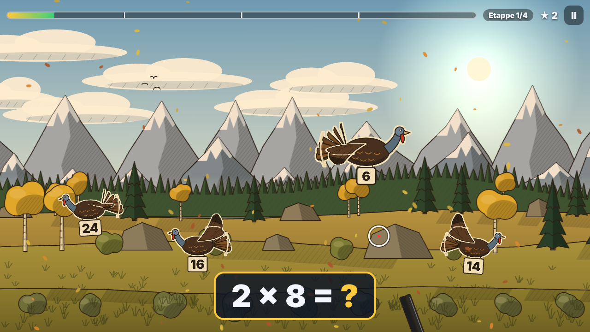
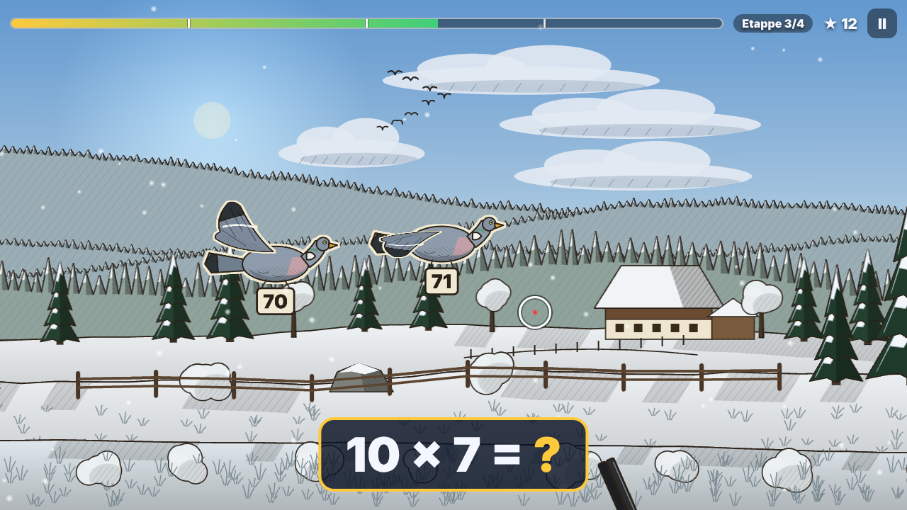
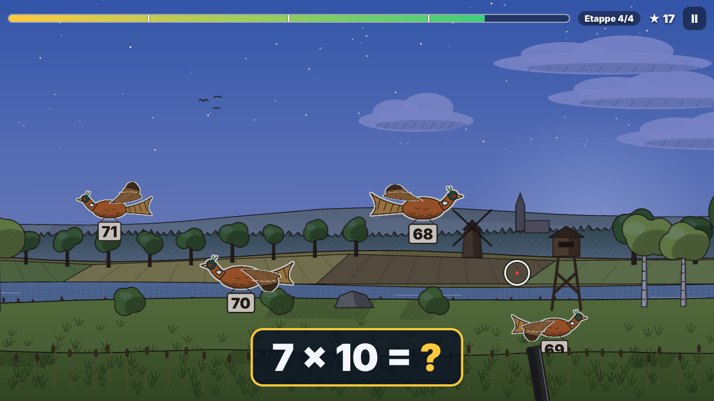
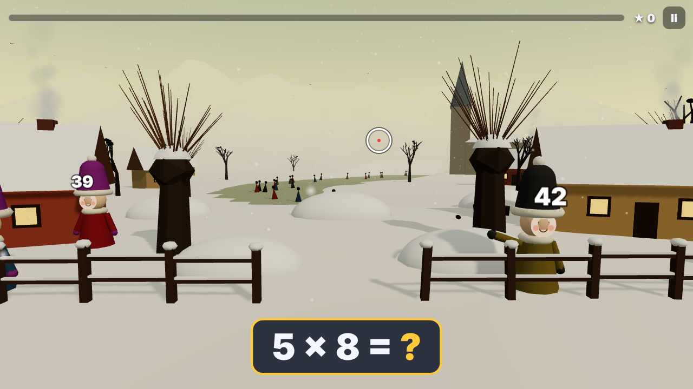

# 1×1 Fun2Learn

Browser-Lernspiel für das kleine und große 1×1 mit 2D-Mehrebenen-Szenen (PixiJS).
Ziele tragen Ergebnisse oder Aufgaben – wer das richtige trifft, kommt weiter.







## Starten

Das Spiel besteht nur aus statischen Dateien, braucht aber einen Webserver
(ES-Module laden nicht über `file://`):

```bash
python3 -m http.server 8000
```

Danach `http://localhost:8000` im Browser öffnen. Alternativ das Repository über
GitHub Pages veröffentlichen.

Bedienung: Maus zielt, Linksklick schießt, Zifferntasten für Ergebnisse, Esc pausiert.

## Stand (v0.3.0)

- Menü: Zahlenraum, Aufgabentopf (u. a. Königsaufgaben, einzelne Reihen, Lernraster, eigene Fehler, Trainer-Auswahl), 4 Spielarten, Einstellungen
- Szenarien: **Truthahn-Skeet** (Jagdreise durch Rocky Mountains, Schwarzwald und Uckermark mit Truthahn, Ringeltaube und Fasan; selbst gezeichnete Ebenen mit Schattierung und Schraffur), **Schneeballschlacht** (Winterdorf nach Bruegel mit eigenen Grafiken, Kameraschwenk, Rauch, Schnee, Vögeln)
- Etappen in beiden Szenarien: nach je 5 gelösten Aufgaben eine Zwischenrunde (Nebel bzw. Schneesturm), danach neues Revier, neue Jahres- oder Tageszeit; Etappenmarken im Fortschrittsbalken
- Ballistik an- und abschaltbar: Flugzeit und Vorhalten auf fliegende Ziele, oder Treffer sofort am Fadenkreuz
- Auswertung je Aufgabe mit empfohlener Übungsserie
- Mehrere Spieler, Lernstand im Browser, Sichern/Laden als JSON-Datei

Geplante Szenarien und Erweiterungen stehen in [spec.md](spec.md), Abschnitt 9, und in den GitHub-Issues.

## Dokumentation

| Datei | Inhalt |
|---|---|
| [spec.md](spec.md) | Spezifikation: Spiellogik, Menü, Szenarien, Architektur, Planung, Entscheidungsprotokoll, Leitfaden für KI-gestützte Weiterarbeit |
| [AGENTS.md](AGENTS.md) | Kurzanleitung für KI-Agenten |
| [tests/](tests) | Browsertests (Playwright), siehe spec.md 8.2 |
| [CHANGELOG.md](CHANGELOG.md) | Versionshistorie |
| [assets/schneeball-bruegel/spec.md](assets/schneeball-bruegel/spec.md) | Asset-Spezifikation der Schneeballschlacht |
| [data/profile.schema.json](data/profile.schema.json) | Datenformat für Spieler, Fortschritt und Statistik |
| [data/beispiel-profil.json](data/beispiel-profil.json) | Beispiel einer Profildatei |

## Lizenzen

PixiJS liegt unter MIT-Lizenz in `vendor/` (siehe `vendor/PIXI-LICENSE`).
Die Grafiken in `assets/vogel-skeet/` zeichnet `tools/build-skeet-assets.py`.
Die Grafiken in `assets/schneeball-bruegel/` sind eigene Zeichnungen (siehe dortige `spec.md`).
