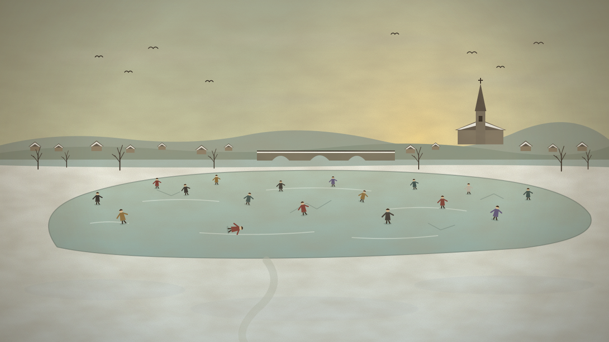
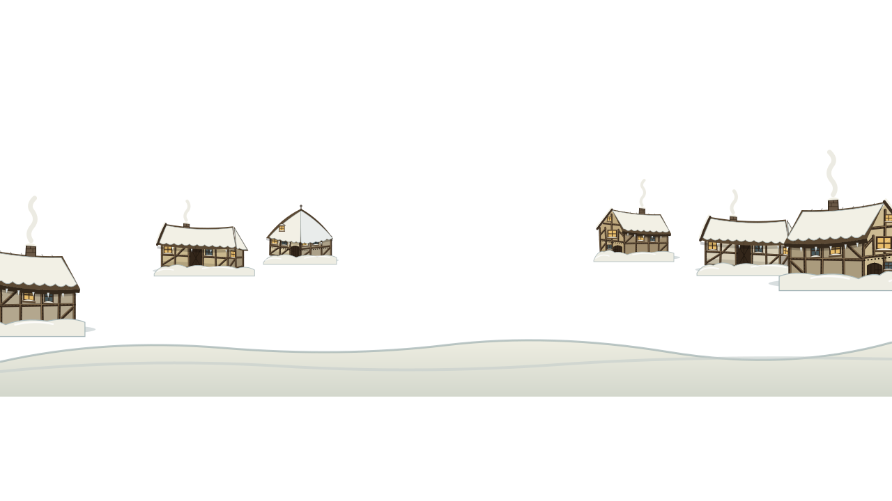
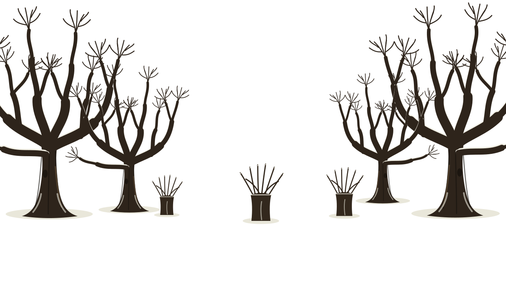
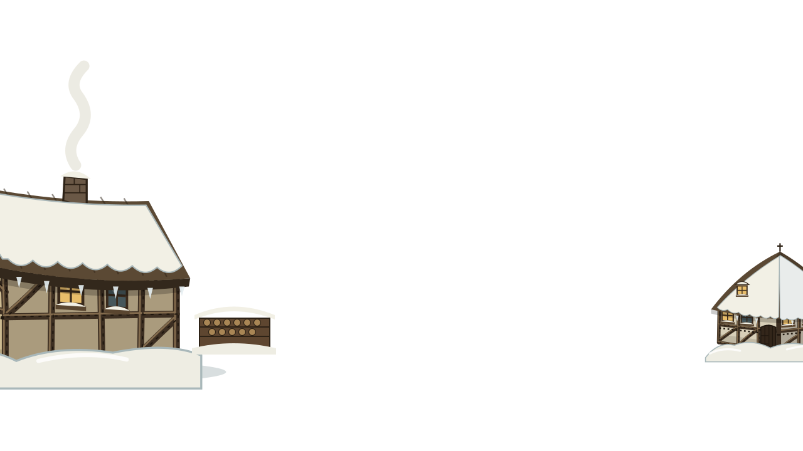
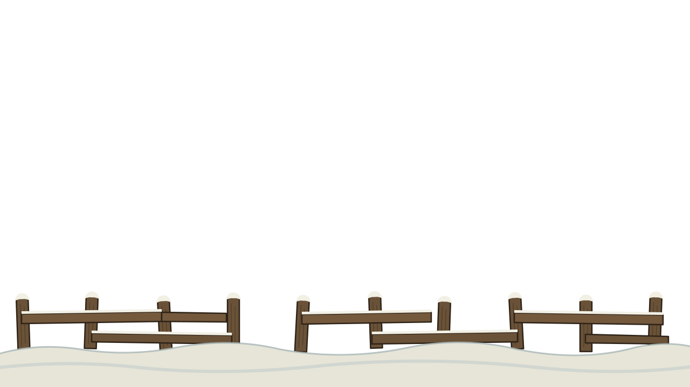
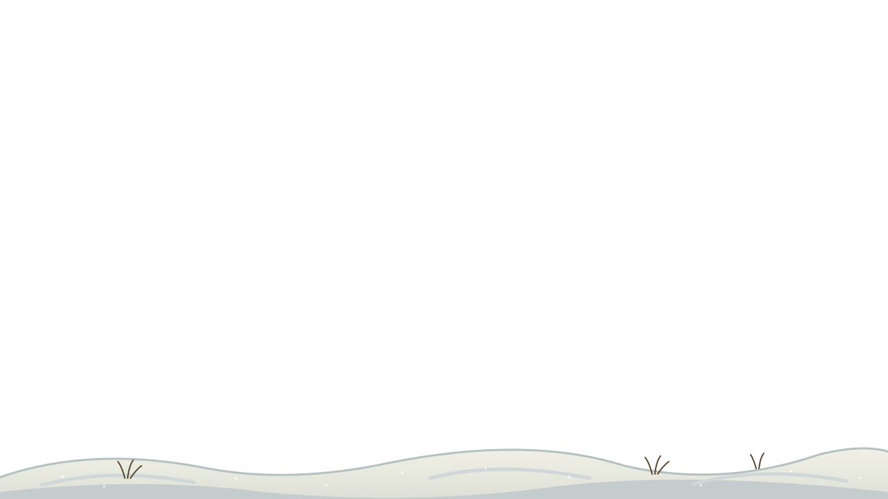
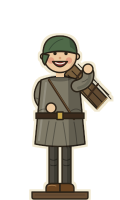

# Asset-Spezifikation: Schneeballspiel „Winter nach Bruegel“

Stand: 15.11.2026 · Format: SVG (Vektor) · Zielgröße der Szene: **1280 × 720 px**

Stilvorlage: Pieter Bruegel d. Ä., *Winterlandschaft mit Eisläufern und Vogelfalle* (1565). Das Gemälde ist gemeinfrei. Die Grafiken sind eigene Zeichnungen im Stil dieser Malerei, keine Kopie.

> Status: Die SVG-Dateien sind formal als XML geprüft. Eine visuelle Abnahme im Zielspiel steht noch aus.

## 1. Ordnerstruktur

```
schneeball-bruegel/
├── spec.md
├── layers/     6 Szenenebenen, je 1280 × 720, deckungsgleich
├── kids/       6 Kinderziele, je 240 × 400
└── sprites/    Requisiten (Vogelfalle, Schneeball, Schneepuff)
```

## 2. Ebenen (hinten → vorn)

Alle Ebenen haben dieselbe Größe und werden bei Position (0, 0) ohne Skalierung übereinandergelegt. Nur Ebene 01 ist deckend, 02–06 sind transparent.

| Z | Datei | Inhalt | Parallax (Vorschlag) |
|---|-------|--------|----------------------|
| 1 | `layers/01-backdrop.svg` | Himmel, Hügel, Dorf und Kirche am Horizont, Brücke, See mit 17 Eisläufern, Schneefeld, Vögel | 0,0–0,1 |
| 2 | `layers/02-haeuser-fern.svg` | Sechs Häuser in Dreiviertelansicht (3 Typen), Uferbank aus Schnee | 0,25 |
| 3 | `layers/03-baeume.svg` | 4 Eichen (kahl, Schnee auf den Ästen), 3 Kopfweiden | 0,40 |
| 4 | `layers/04-haus-nah.svg` | Großes Haus links (angeschnitten), Holzstapel, Speicherhaus rechts | 0,55 |
| 5 | `layers/05-zaun.svg` | Holzzaun mit Schneekappen, Schneefuß | 0,75 |
| 6 | `layers/06-schnee-vorn.svg` | Schneewehen im Vordergrund, Grasbüschel | 1,0 |

Parallax: Faktor 1,0 bedeutet, die Ebene bewegt sich genauso weit wie die Kamera. Kleinere Werte wirken weiter entfernt.

## 3. Kinderziele

Jede Datei ist 240 × 400 px. Das Kind steht auf einer Fußleiste (Holzbrett) an der Unterkante.

| Datei | Figur | Kleidung | Haltung |
|-------|-------|----------|---------|
| `kind-1-winker.svg` | Winker | rote Tunika, ocker Mütze | winkt mit rechter Hand |
| `kind-2-schlitten.svg` | Schlittenkind | blaugrüne Tunika, braune Gugel | zieht kleinen Schlitten |
| `kind-3-werfer.svg` | Werfer | gelbe Jacke, rote Mütze | holt zum Wurf aus |
| `kind-4-eislaeufer.svg` | Eisläufer | violette Tunika, helle Haube | Arme ausgebreitet, ein Bein hinten |
| `kind-5-holztraeger.svg` | Holzträger | graubraune Tunika, grüne Haube | Reisigbündel auf dem Rücken |
| `kind-6-jubel.svg` | Jubler | blaue Tunika, rote Hose, Barett mit Feder | beide Arme hoch |

- **Gesicht:** alle mit fröhlichem Gesicht (Lächeln, Wangenröte).
- **Schattierung:** Faltenwurf und Schatten auf der rechten Körperseite (Licht von links).
- **Papierrand:** heller Rand wie bei einem Ausschneidebild, erzeugt durch den Filter `rim`.

### Maße im Sprite-Koordinatensystem (240 × 400)

- **Drehpunkt zum Umklappen:** Mitte der Unterkante, (120, 398).
- **Fußleiste:** y = 384 bis 398.
- **Kopf (Treffer):** Kreis, Mittelpunkt (120, 112), Radius 33.
- **Körper (Treffer):** Rechteck x 82–170, y 146–290.
- **Beine:** nicht als Trefferfläche vorgesehen.

### Platzierung in der Szene

Formeln für ein Kind mit Skalierung `s`, Mittelpunkt `cx` und Fußlinie `feetY`:

- `left = cx − 120·s`
- `top = feetY − 398·s`
- `width = 240·s`, `height = 400·s`

| Reihe | s | feetY | Z-Position | Verdeckt durch |
|-------|---|-------|------------|----------------|
| A (hinten) | 0,40 | 525 | zwischen Ebene 2 und 3 | Uferbank in Ebene 02 |
| B (Mitte) | 0,62 | 655 | zwischen Ebene 4 und 5 | Zaun und Schneefuß in Ebene 05 |
| C (vorn) | 0,85 | 705 | zwischen Ebene 5 und 6 | Schneewehen in Ebene 06 |

Beispielhafte Mittelpunkte in der Vorschau: Reihe A cx = 250, 520, 780, 1010 · Reihe B cx = 180, 470, 760, 1060 · Reihe C cx = 330, 650, 1000.

### Auftauchen und Wegklappen (Vorschlag)

- **Auftauchen:** Das Kind schiebt sich von unten nach oben in Position (`translateY` von `+height` auf 0). Die Ebene davor verdeckt die Füße. Dauer ca. 250 ms.
- **Wegklappen (Treffer):** Drehung um die Unterkante nach hinten, `rotateX` 0 → 80–90°, Ursprung (50 %, 100 %), Dauer ca. 180–250 ms. Danach ausblenden und Schneepuff zeigen.

## 4. Sprites

| Datei | Größe | Verwendung |
|-------|-------|------------|
| `sprites/vogelfalle.svg` | 200 × 160 | Requisite im Mittelgrund (Bruegel-Motiv). In der Vorschau: left 830, top 538, Breite 140, zwischen Reihe B und Ebene 05 |
| `sprites/schneeball.svg` | 64 × 64 | Geschoss. Drehpunkt in der Mitte |
| `sprites/schneepuff.svg` | 160 × 160 | Trefferfeedback. Kurz skalieren (0,6 → 1,2) und ausblenden |

## 5. Farbpalette

| Verwendung | Hex |
|------------|-----|
| Himmel oben / Horizont | `#a3a78f` / `#e6dba9` |
| Schnee hell / Schatten | `#ecebde` / `#c3cbc6` |
| Eis | `#b6c6b3` bis `#92a89f` |
| Schneedach | `#f2f0e5` |
| Holz dunkel / Balken-Lichtkante | `#3d2f22` / `#8f7655` |
| Reetdach | `#5b4934` |
| Papierrand der Kinder | `#f1e9d2` |
| Kinderkleidung | `#a8453a`, `#4f7a73`, `#d1a13f`, `#6a5a7e`, `#7f7a68`, `#3f5f86` |

## 6. Technische Hinweise

- **Einbindung:** als `` oder als CSS-Hintergrund. Nicht inline einbetten.
- **Filter-Kosten:** Jedes Kind nutzt einen SVG-Filter (`feMorphology`) für den Papierrand, der Backdrop nutzt `feTurbulence` für die Maltextur. Bei vielen gleichzeitig bewegten Kindern kann das den Browser belasten.
- **Empfehlung für den Spielbetrieb:** Die SVGs einmalig in PNG oder WebP rastern, mit Faktor 2 für Retina-Displays. Beispielgrößen: Kinder 480 × 800, Ebenen 2560 × 1440. Werkzeuge: `resvg`, `sharp` (Node) oder Inkscape.
- **Ebenen als Bild:** Ebene 01 darf als JPG/WebP ohne Alphakanal exportiert werden, die übrigen als PNG/WebP mit Alpha.
- **Koordinaten:** Alle Positionen der Ebenen sind im 1280 × 720-Raster abgestimmt. Bei Skalierung der gesamten Szene alle Ebenen gemeinsam skalieren.

## 7. Minimalbeispiel (HTML/CSS)

```html
<div id="szene" style="position:relative;width:1280px;height:720px;overflow:hidden">
  
  
  <!-- Reihe A: Kinder hier einfügen -->
  
  
  <!-- Reihe B -->
  
  <!-- Reihe C -->
  
</div>
```

Kind der Reihe B (s = 0,62, cx = 470, feetY = 655):

```html

```

Wegklappen:

```css
.kind.hit { transition: transform .22s ease-in;
            transform: perspective(700px) rotateX(80deg); }
```

## 8. Entscheidungen

- **SVG statt Raster:** Skalierbar, kleine Dateien, die Ebenen lassen sich exakt aufeinander abstimmen, und Farben lassen sich im Code anpassen. Ein KI-Bildgenerator wäre für deckungsgleiche transparente Ebenen und sechs konsistente Figuren mit gemeinsamem Drehpunkt ungeeignet.
- **Drei Kinderreihen mit je eigener Verdeckungsebene:** So tauchen die Kinder zwischen den Ebenen auf, ohne dass Masken im Code nötig sind.
- **Dreiviertelansicht der Häuser:** Dadurch wirkt der Raum tiefer. Balken, Fenster und Dächer sind bewusst nicht lotrecht.

## 9. Offene Punkte

- Visuelle Abnahme der Szene im Spiel und ggf. Feinabstimmung (Farben, Dichte der Eisläufer).
- Rechtliche Einordnung: Die Vorlage von Bruegel ist gemeinfrei. Für die eigenen Grafiken sollte vor einer kommerziellen Veröffentlichung geklärt werden, wie die Urheberschaft zu dokumentieren ist, da sie mit KI-Unterstützung entstanden sind.
